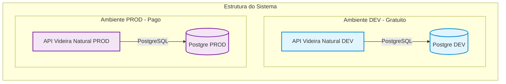

# 🏛️ Estrutura do Sistema Videira Natural

Arquitetura atual de infraestrutura do sistema. O ambiente de **Desenvolvimento (DEV)** roda 100% em serviços gratuitos, enquanto o ambiente de **Produção (PROD)** é centralizado no Railway para maior estabilidade.

---

## 🗺️ Mapa de Arquitetura Atualizado

---

## 💰 Provedores e Controle de Custos

| Componente | Ambiente | Provedor / Serviço | Plano Atual | Custo Mensal |
| :--- | :--- | :--- | :--- | :--- |
| **PostgreSQL** | DEV | Supabase | Free Tier | $0.00 |
| **API Videira Natural** | DEV | Render | Free Tier | $0.00 |
| **PostgreSQL** | PROD | Railway | Plan Hobby | Compartilhado ($10 max) |
| **API Videira Natural** | PROD | Railway | Plan Hobby | Compartilhado ($10 max) |

### 🛑 Teto Orçamentário (Budget)
* **Valor Máximo Global:** **$10.00 USD / mês**
* *Nota: O ecossistema de DEV não consome nada deste orçamento.*
